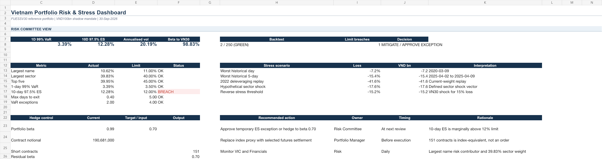

# Vietnam Portfolio Risk & Stress Lab

[](https://vietnam-risk-stress-dashboard.solar-grebe-2278.chatgpt.site)
[](https://github.com/thvh2006/vietnam-portfolio-risk-stress-lab/releases/tag/v1.1.0)



Point-in-time market-risk case built on the publicly disclosed SSIAM VN30 ETF portfolio. The project scales the 30-stock portfolio to a VND100 billion shadow mandate and asks whether its market, concentration and liquidity risks fit an explicit risk budget.

The case uses real holdings and market data. It is an independent portfolio demonstration, not an analysis performed for SSIAM and not a recommendation that the passive ETF should hedge.

## Decision question

At the 30 September 2026 information cutoff:

1. Where does the portfolio's risk come from by stock and sector?
2. How much can the mandate lose under ordinary and stressed conditions?
3. Does a rolling current-weight VaR diagnostic show acceptable exception coverage and independence?
4. If a risk limit is breached, what VN30 futures overlay reduces risk with the least tracking disruption?

## Real case

- Reference portfolio: SSIAM VN30 ETF (`FUESSV30`).
- Benchmark: VN30 Index.
- Holdings date: 30 September 2026.
- Disclosure date: 7 October 2026.
- Reported holdings: 30 stocks plus cash.
- Shadow mandate NAV: VND100 billion.
- Hedge instrument: VN30 Index futures, contract multiplier VND100,000 per index point.

## Published outputs

- **[Live decision dashboard](https://vietnam-risk-stress-dashboard.solar-grebe-2278.chatgpt.site):** interactive hedge sizing, margin, approximate VaR and liquidity scenario controls. Historical risk outputs remain frozen to the reviewed snapshot.
- **[GitHub Release v1.1.0](https://github.com/thvh2006/vietnam-portfolio-risk-stress-lab/releases/tag/v1.1.0):** downloadable review copies of the workbook and committee report.
- [`Vietnam_Portfolio_Risk_Stress_Lab.xlsx`](Vietnam_Portfolio_Risk_Stress_Lab.xlsx): formula-linked decision workbook. Risk statistics are Python snapshots; limits, hedge sizing and margin liquidity are live Excel formulas.
- [`Vietnam_Portfolio_Risk_Stress_Report.pdf`](output/pdf/Vietnam_Portfolio_Risk_Stress_Report.pdf): eight-page risk committee report.
- `src/portfolio_risk/engine.py`: dependency-light independent Python risk engine.
- `reports/`: coverage, component-risk, liquidity, stress and VaR backtesting outputs.
- [`data/DATA_MANIFEST.md`](data/DATA_MANIFEST.md): frozen evidence-set hashes and retrieval cutoff.
- [`docs/INVESTMENT_COMMITTEE_MEMO.md`](docs/INVESTMENT_COMMITTEE_MEMO.md): decision memo.
- [`MODEL_CARD.md`](MODEL_CARD.md): intended use, validation, limitations and monitoring policy.

## Three-minute review

1. Open the [live dashboard](https://vietnam-risk-stress-dashboard.solar-grebe-2278.chatgpt.site): the decision and seven limit results are visible above the fold.
2. Change target beta, NAV, futures level, margin or participation rate and inspect the hedge economics immediately.
3. Download the workbook or PDF from [Release v1.1.0](https://github.com/thvh2006/vietnam-portfolio-risk-stress-lab/releases/tag/v1.1.0) to audit the calculations and committee recommendation.

## Key result

The portfolio passes the 3.50% one-day 99% VaR limit at 3.40%. Direct overlapping 10-day 97.5% ES is 9.30%, below the 12.00% limit; the square-root-of-time challenge is 12.30% and is deliberately shown as a conservative comparison rather than the limit-owning estimate. The rolling current-weight diagnostic has 2 exceptions in 250 observations, with Kupiec and Christoffersen tests not rejected at 5%.

The workbook calculates an index-equivalent hedge of 152 short contracts to reduce beta from 0.99 to 0.70. At the 17% VSDC minimum initial-margin input, the illustration requires about VND4.93 billion, rising to VND7.39 billion under the 1.5x liquidity buffer. This is a contingency scenario, not an order.

The investment outcome is mandate-dependent:

- **Current risk budget:** retain the unhedged portfolio. Direct 10-day ES and all other approved limits pass.
- **Tighter absolute-risk mandate:** hedge toward beta 0.70 after execution controls. The replayed overlay reduces historical 99% VaR from 3.40% to 2.46%, but raises tracking error from 2.35% to 6.52%.

The model challenge is intentionally visible. Normal 99% VaR is 2.87%, historical VaR is 3.40% and Cornish-Fisher VaR is 4.17%. Negative skewness and excess kurtosis make a normal-only conclusion unreliable.

## Analytical depth

- 500-day and 250-day historical VaR/ES;
- EWMA volatility and rolling risk regimes;
- Cornish-Fisher non-normality challenge;
- Euler component volatility and component VaR;
- sector risk-to-weight decomposition;
- historical, hypothetical, correlation and reverse stress;
- rolling current-weight VaR diagnostic with traffic-light, Kupiec POF, Christoffersen independence and conditional coverage;
- direct overlapping 10-day ES with square-root-of-time challenge comparison;
- covariance positive-semidefinite validation and peer-median proxy volatility floors;
- simultaneous liquidity stress and futures margin-liquidity buffer;
- target-beta sensitivity and before/after hedge economics;
- liquidity capacity and explicit short-history proxy audit.

## Reproduce

```bash
python3 scripts/run_risk.py
python3 scripts/run_checks.py
python3 -m unittest discover -s tests -v
```

The market snapshot is frozen under `data/market/`. Re-fetching changes the evidence set and should be treated as a new model run.
